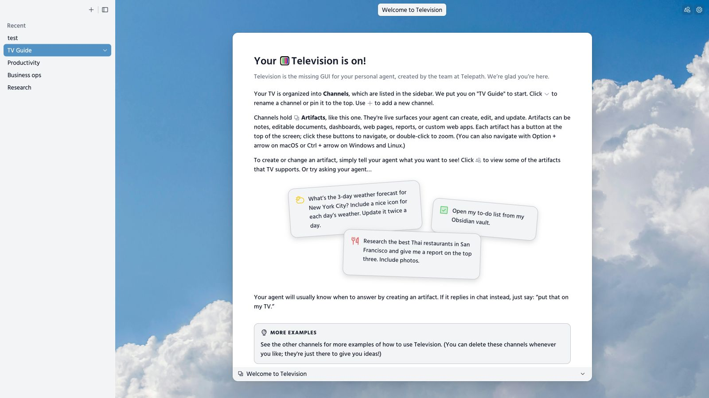
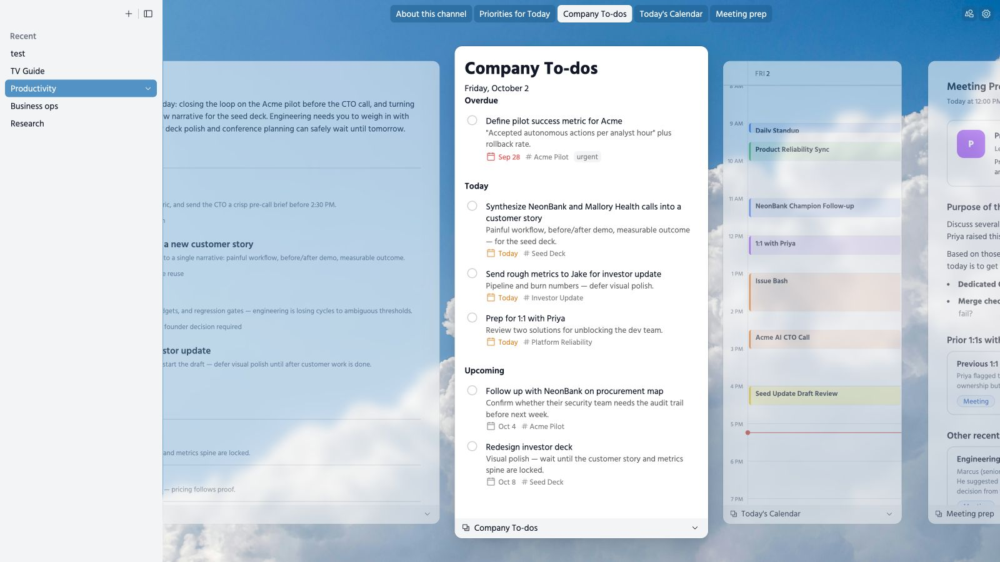
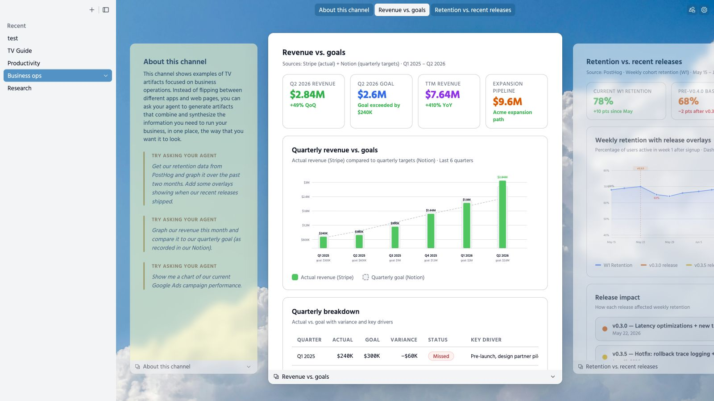
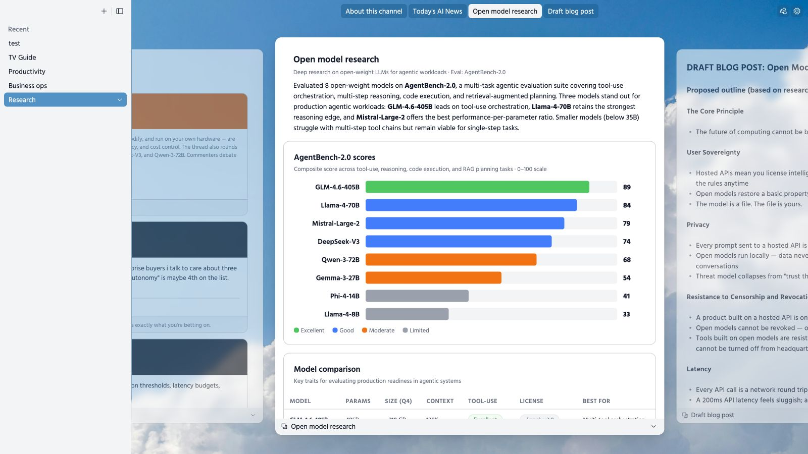

# Television for Pinokio

A one-click launcher for [Television](https://github.com/telepath-computer/television), a visual workspace where personal agents create and update documents, HTML apps, tables, and other persistent artifacts.

This launcher installs the published `@telepath-computer/television` npm package, including its ready-built browser client, server, and agent skills. It uses a private Node 24 and npm 11 runtime. Television works alongside an existing agent with skills and file access; the launcher does not install an agent or model.

The install and start commands are shared across macOS, Linux, and Windows. The launcher has been tested on macOS; a complete native Windows install and start still needs verification. Upstream does not officially support Windows agents. This launcher runs the browser server in the foreground through Pinokio.

## Screenshots

Captured from the running launcher at **1600 × 900**. These show Television's bundled onboarding demos; names, business metrics, news, and model comparisons are illustrative sample content.

**Welcome — channels and persistent artifacts**



**Productivity — to-dos alongside priorities, a calendar, and meeting prep**



**Business operations — revenue goals, charts, and quarterly breakdowns**



**Research — visual comparisons alongside news and an editable draft**



## Use

1. Open **Television** in Pinokio and click **Install** to download the app and its private runtime.
2. Click **Start**. **Open Web UI** opens automatically when the server is ready.
3. Use your agent alongside the browser interface to create artifacts.

The server listens on `127.0.0.1` at an available port selected by Pinokio. The Web UI link includes Television's access token. Stop it with Pinokio's built-in **Stop** control.

- **Update** pulls the launcher when it has an `origin` remote and installs the latest published Television package.
- **Reinstall** installs the latest published package and repairs missing dependencies.
- **Reset** removes the app installation and private runtime so you can install again. It preserves `data/`, including your channels, artifacts, and access token.

Stop the server before reinstalling, updating, or resetting. The launcher hides those controls while it runs.

The browser client is experimental. External web pages can refuse browser embedding; the upstream macOS desktop client supports additional embedded-page features.

## Connect an agent

The package includes Television's agent skills. From a Pinokio terminal in this launcher folder, install them into the skills directory used by your agent:

```sh
./runtime/node_modules/node/bin/node app/release/node_modules/@telepath-computer/television/dist/cli.cjs --home data skills install /absolute/path/to/your/agent/skills
```

Replace the destination with your agent's actual skills folder. This command replaces existing Television skills there. Refresh the agent's skills afterward. Repeat after updating Television.

Give the agent the launcher folder path and tell it to use this CLI invocation, so it connects to this launcher's data and current port:

```sh
./runtime/node_modules/node/bin/node app/release/node_modules/@telepath-computer/television/dist/cli.cjs --home data status
./runtime/node_modules/node/bin/node app/release/node_modules/@telepath-computer/television/dist/cli.cjs --home data --help
./runtime/node_modules/node/bin/node app/release/node_modules/@telepath-computer/television/dist/cli.cjs --home data list-channels
```

On Windows, use the executable directly from Command Prompt or PowerShell:

```powershell
.\runtime\node_modules\node\bin\node.exe app/release/node_modules/@telepath-computer/television/dist/cli.cjs --home data skills install "C:\path\to\your\agent\skills"
.\runtime\node_modules\node\bin\node.exe app/release/node_modules/@telepath-computer/television/dist/cli.cjs --home data status
.\runtime\node_modules\node\bin\node.exe app/release/node_modules/@telepath-computer/television/dist/cli.cjs --home data list-channels
```

The current port is saved in `data/config.json`; the bearer token is in `data/state/token`. Both persist across restarts, although the port can change on each launch. The launcher uses an isolated Television home rather than the default `~/.television` folder.

## HTTP API

Start Television first. The API accepts `Authorization: Bearer <token>`. Core endpoints:

| Method | Endpoint | Purpose |
| --- | --- | --- |
| GET | `/health` | Server health |
| GET / POST | `/channels` | List or create channels |
| GET / POST | `/artifacts` | List or register artifacts |
| GET | `/artifacts?channelID=<id>` | List a channel's artifacts |
| PATCH | `/artifacts/<id>` | Update an artifact's title, path, or URL |
| GET | `/display` | Read display state |
| POST | `/display/focus` | Focus an artifact using `{"artifactID":"<id>"}` |

Path artifacts reference an existing absolute path to a Markdown file, HTML file, or folder containing `index.html`. Edit that source file to update its content. URL artifacts use `kind: "url"` and `url` instead of `path`.

### JavaScript (Node)

Run from the launcher folder. This example creates a channel and registers an existing local document:

```js
import { readFile } from "node:fs/promises";
import path from "node:path";

const { port } = JSON.parse(await readFile("data/config.json", "utf8"));
const token = (await readFile("data/state/token", "utf8")).trim();
const base = `http://127.0.0.1:${port}`;
async function api(endpoint, body) {
  const response = await fetch(base + endpoint, {
    method: body ? "POST" : "GET",
    headers: { Authorization: `Bearer ${token}`, "Content-Type": "application/json" },
    ...(body ? { body: JSON.stringify(body) } : {})
  });
  if (!response.ok) throw new Error(await response.text());
  return response.json();
}
const { channel } = await api("/channels", { name: "My work" });
const { artifact } = await api("/artifacts", {
  kind: "path", channelID: channel.id, title: "My document",
  path: path.resolve("/absolute/path/to/document.md")
});
await api("/display/focus", { artifactID: artifact.id });
```

### Python (standard library)

```python
import json
from pathlib import Path
from urllib.request import Request, urlopen

port = json.loads(Path("data/config.json").read_text())["port"]
token = Path("data/state/token").read_text().strip()
base = f"http://127.0.0.1:{port}"

def api(endpoint, body=None):
    request = Request(base + endpoint,
        data=json.dumps(body).encode() if body is not None else None,
        headers={"Authorization": f"Bearer {token}", "Content-Type": "application/json"})
    with urlopen(request) as response:
        return json.load(response)

channel = api("/channels", {"name": "My work"})["channel"]
artifact = api("/artifacts", {
    "kind": "path", "channelID": channel["id"], "title": "My document",
    "path": str(Path("/absolute/path/to/document.md").resolve())
})["artifact"]
api("/display/focus", {"artifactID": artifact["id"]})
```

### Curl

Set `TV_URL` to the current server address without its token query. Set `TV_TOKEN` to the contents of `data/state/token`. Run these examples in Bash (including Pinokio's bundled Bash on Windows).

```sh
export TV_URL="http://127.0.0.1:<current-port>"
export TV_TOKEN="<token-from-data/state/token>"
curl --fail-with-body "$TV_URL/health"
curl --fail-with-body -H "Authorization: Bearer $TV_TOKEN" "$TV_URL/channels"
curl --fail-with-body -X POST "$TV_URL/channels" \
  -H "Authorization: Bearer $TV_TOKEN" -H "Content-Type: application/json" \
  -d '{"name":"My work"}'
curl --fail-with-body -X POST "$TV_URL/artifacts" \
  -H "Authorization: Bearer $TV_TOKEN" -H "Content-Type: application/json" \
  -d '{"kind":"path","channelID":"<channel-id>","title":"My document","path":"/absolute/path/to/document.md"}'
curl --fail-with-body -X POST "$TV_URL/display/focus" \
  -H "Authorization: Bearer $TV_TOKEN" -H "Content-Type: application/json" \
  -d '{"artifactID":"<artifact-id>"}'
```

## Files and troubleshooting

`app/release/` contains the published npm package and its dependencies. `runtime/` contains the private Node/npm toolchain. `data/` contains Television's configuration, state, and onboarding content. These generated folders are excluded from Git.

Existing source installations can use **Reinstall** to switch to the published package. Their old checkout stays in `app/` until **Reset**, and their `data/` is preserved.

Published releases enable anonymous, content-free usage telemetry by default. An agent can turn it off using the CLI invocation above with `telemetry disable`. The preference is saved in `data/` and survives updates. See the [administrator guide](https://television.run/install.md) for details.

Check `logs/api/install.js/latest` or `logs/api/start.js/latest` first if installation or startup fails. Reinstall repairs missing packages. Back up the entire `data/` folder before moving the launcher to another machine.

Television's upstream code and the included icon are MIT licensed. See [the upstream license](https://github.com/telepath-computer/television/blob/main/LICENSE).
